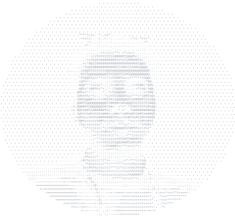
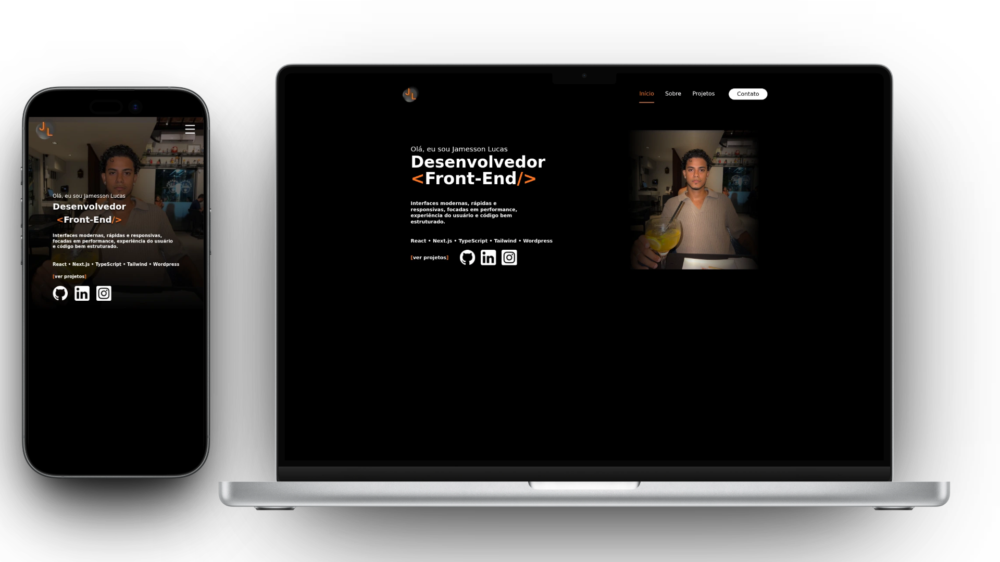

<p align="center">
  
</p>

<p align="center">
  <a href="https://portfoliojamessonlucas.vercel.app/"></a>
  <a href="https://www.linkedin.com/in/jamesson-lucas-78b594207/"></a>
  <a href="mailto:jamessonlucas01@gmail.com"></a>
</p>

---

### 👋 Sobre mim



Sou desenvolvedor Front-end e trabalho com **React e TypeScript** numa aplicação web em produção, com contribuições no back-end (**Node.js, Express e MySQL**). Gosto de transformar telas do Figma em interfaces responsivas e de deixar a web mais rápida: no último projeto, levei a nota mobile do PageSpeed de **8 para 79**.

```ts
const jamesson = {
  cargo: "Desenvolvedor Front-end",
  local: "Recife, PE",
  stack: ["React", "Next.js", "TypeScript", "Node.js"],
  gosto: ["performance web", "UX", "entregas de ponta a ponta"],
  estudando: ["testes automatizados", "acessibilidade"],
};
```

<br clear="right" />

### 🛠️ Stack

<p align="center">
  
</p>

### 🚀 Projetos em destaque

| Projeto | Sobre |
|---|---|
| [**Meu Portfólio**](https://portfoliojamessonlucas.vercel.app/) | Quem sou, o que já fiz e como falar comigo. |
| [**Portfolio-james**](https://github.com/James-Script/Portfolio-james) | Código-fonte do portfólio. |
| [**Fontea**](https://github.com/James-Script/Fontea) | Sistema de geração de briefings institucionais. |

<p align="center">
  <a href="https://portfoliojamessonlucas.vercel.app/"></a>
</p>

### 📈 Atividade

<p align="center">
  
</p>

<p align="center">
  
</p>


