  

  

<h3>$ ls ~/projetos</h3>

<table>
  <tr>
    <td><a href="https://portfoliojamessonlucas.vercel.app/"><b>portfólio</b></a></td>
    <td>quem sou, o que já fiz e como falar comigo</td>
    <td><code>next.js</code></td>
  </tr>
  <tr>
    <td><a href="https://github.com/James-Script/Portfolio-james"><b>portfolio-james</b></a></td>
    <td>código-fonte do portfólio</td>
    <td><code>react</code></td>
  </tr>
  <tr>
    <td><a href="https://github.com/James-Script/Fontea"><b>fontea</b></a></td>
    <td>geração de briefings institucionais</td>
    <td><code>web</code></td>
  </tr>
</table>

<h3>$ git log --graph</h3>

<h3>$ ssh jamesson@recife</h3>

  <a href="https://portfoliojamessonlucas.vercel.app/">portfoliojamessonlucas.vercel.app</a> &nbsp;·&nbsp;
  <a href="https://www.linkedin.com/in/jamesson-lucas-78b594207/">linkedin.com/in/jamesson-lucas</a> &nbsp;·&nbsp;
  <a href="mailto:jamessonlucas01@gmail.com">jamessonlucas01@gmail.com</a>

